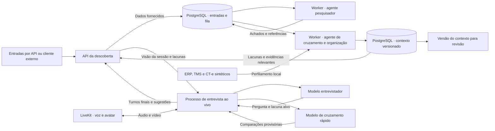

# Arquitetura da descoberta da Korda

**Plano iniciado em 19/11/2026 · recorte de backend atualizado por Marcus em 24/11/2026**

A descoberta começa com informações fornecidas pelo cliente, passa por pesquisa e entrevista adaptativa e termina com uma versão do contexto que expõe evidências, conflitos e lacunas. O recorte usa a transportadora fictícia com ERP, TMS e CT-e sintéticos. O último passo deste plano é disponibilizar essa versão para a frente do Gabriel. [Escopo](scope.md) · [Arquitetura de referência](architecture.md) · [Caso sintético e roteiro](plano-entrevista-dados-sinteticos.md)

**Alinhamento de 23/11/2026.** O PR #18 de Gabriel fornece as fontes de referência: uma entrega por pedido, quantidades em volumes e vínculo TMS → pedido ERP → NF-e → CT-e. Nas ambiguidades do desenho anterior, esse é o recorte adotado. O [contrato de contexto v0.1.0](../packages/contracts/context/v0.1.0/README.md) possui schema e exemplos de rateio pendente/confirmado. Os processos e integrações descritos abaixo ainda serão implementados.

## Escopo e situação atual

Marcus desenvolverá o **backend da descoberta**. Outro integrante está desenvolvendo o frontend; a conexão e os complementos necessários na interface serão tratados depois que ela estiver pronta. Este plano não escolhe framework de frontend nem inclui implementação de telas em `apps/web/`. A entrega do backend será verificável por API, cliente de terminal e testes.

Os itens 1 e 2 do planejamento de Marcus produziram ajustes técnicos da revisão e o contrato local de contexto. O item 3 está preparado: [formulário, páginas e falas sintéticas](../data/synthetic/discovery/README.md), [estados de referência e cinco cenários](../evaluation/discovery/README.md). Isso não conclui as issues K01/K02 nem demonstra um serviço funcionando. Os **itens 4 e 5 abaixo são o trabalho restante**, com integração ao frontend posterior. A numeração desses itens é a do planejamento de Marcus, não a dos IDs K01–K17.

O desenvolvimento se concentra em `services/context/`, nos contratos compartilhados em `packages/contracts/`, na infraestrutura necessária em `infra/` e nos testes da descoberta. O código do planejador/executor de Gabriel permanece em sua frente. A autenticação da equipe e a leitura P1 → P2 precisam de alinhamento conjunto antes de integrar seus consumidores.

## Arquitetura proposta

**Um monorepositório e uma imagem Python compartilhada.** O item 4 começa com três processos: API, worker de pesquisa e worker de contexto. O item 5B acrescenta o quarto processo, de entrevista ao vivo. O worker de contexto coordena o organizador e a geração das próximas perguntas no modo texto. O mesmo organizador trabalha antes, durante e depois da entrevista; é o único componente autorizado a atualizar o contexto canônico. O pesquisador entrega achados, e o entrevistador entrega perguntas. Os processos podem ficar no mesmo host na demo e reiniciar separadamente.

| Processo | Interface e responsabilidade |
| --- | --- |
| API | Recebe informações iniciais, registra entradas e turnos, cria sessões de texto/voz, consulta lacunas e disponibiliza versões do contexto. Autoriza acesso por projeto e enfileira trabalho junto da entrada persistida. |
| Pesquisa | Lê apenas as informações necessárias ao seu trabalho, usa ferramentas de pesquisa pública e entrega achados com origem. Publica entradas para o organizador. |
| Entrevista ao vivo | Recebe transcrição e eventos da sala, roda os dois modelos rápidos, registra os turnos na API e dita apenas a pergunta ou mensagem selecionada. Consulta as lacunas pelo mesmo endpoint usado pelo texto. |
| Contexto | Coordena os jobs do organizador e do entrevistador por texto. O organizador valida propostas, atualiza afirmações e lacunas e publica revisões em transação. O worker também executa os jobs determinísticos de perfilamento e fechamento. |

## 1. Pré-onboarding e pesquisa

1. O formulário recebe nome e domínio da empresa quando disponíveis, setor, objetivo do projeto e sistemas ou fontes já conhecidos. Cada campo vira uma entrada **fornecida**, com autor, horário e projeto. O usuário pode corrigir a entrada em uma nova revisão.
2. O **agente pesquisador** gera consultas em duas frentes. A primeira busca a própria empresa e valida a identidade com domínio, localização e outros dados públicos informados. A segunda procura a cadeia de dados provável, com referências do setor, documentação de sistemas citados, formatos como CT-e e fontes de parceiros ou fornecedores que tenham vínculo público identificável. Cada achado indica se descreve **a empresa** ou **uma prática do setor**, a URL, o trecho e a data de captura. Uma empresa ambígua continua marcada como tal. Na demo, os dados da transportadora vêm de páginas fictícias reproduzíveis. A busca pública pode complementar o caso com referências do setor.
3. O organizador recebe um lote com grupos **fornecidas** e **descobertas**. Dentro de descobertas, mantém empresa e setor distinguíveis. Relaciona sistemas, processos, entidades e indicadores, verifica o que veio de cada fonte e propõe as primeiras lacunas. Uma referência setorial sobre TMS pode justificar a pergunta “onde vocês registram a entrega?”. A identificação do sistema usado pela empresa depende de evidência sobre aquela empresa.
4. A API apresenta o briefing com evidências e lacunas priorizadas. O estado da pesquisa fica visível como em andamento, concluída ou parcial. Falha ou limite de busca preserva os achados disponíveis e permite começar a entrevista com as informações fornecidas.

| Função | Stack sugerida |
| --- | --- |
| Entrada e validação | FastAPI + Pydantic v2 para receber e persistir os campos por API. OpenAPI e exemplos JSON documentam o contrato para o cliente de terminal e para a futura integração com a interface da equipe. [FastAPI e schemas](https://fastapi.tiangolo.com/tutorial/schema-extra-example/) |
| Agente pesquisador | **Claude Haiku 5.5** (`claude-haiku-5-5`), SDK `anthropic`, com tarefas e ferramentas explicitamente tipadas em Python. A aplicação controla limite de consultas, páginas, duração e orçamento do job. [Modelos Claude](https://platform.claude.com/docs/en/models/overview) · [Structured Outputs](https://platform.claude.com/docs/en/build-with-claude/structured-outputs) |
| Pesquisa e extração públicas | **Tavily Search + Extract** via `httpx`. Usar Search para descobrir URLs e Extract nas selecionadas. Guardar trecho com URL, data de captura e referência à versão do conteúdo. As chamadas recebem somente termos aptos a consulta pública. Bancada de testes com resultados de busca e páginas fixados. [Tavily Search](https://docs.tavily.com/documentation/api-reference/endpoint/search) · [Tavily Extract](https://docs.tavily.com/documentation/api-reference/endpoint/extract) |

## 2. Entrevista por voz ou mensagem

A sessão começa com o briefing, a última revisão do contexto e as lacunas ordenadas. Cada sessão tem um ID da Korda. Salas de voz e retomadas por texto apontam para esse ID. A API associa cada pergunta à lacuna que motivou a escolha e distingue pergunta gerada, apresentada e, em voz, interrompida.

| Papel | Modelo e responsabilidade |
| --- | --- |
| Entrevistador | **Claude Haiku 5.5**. Com uma lista de lacunas elegíveis, o histórico recente e as sugestões disponíveis, escolhe o que perguntar, se deve esclarecer a resposta ou se a conversa pode ser encerrada. Retorna a lacuna escolhida e uma pergunta curta em português. A aplicação valida o alvo antes de falar ou mostrar a pergunta. |
| Cruzamento rápido ao vivo | **Gemini 3.1 Flash-Lite** (`gemini-3.1-flash-lite`), SDK `google-genai`. Compara a fala recente com as lacunas e evidências relacionadas. Retorna sugestões de vínculo, resposta parcial, contradição ou termo ambíguo, apontando o trecho que motivou cada sugestão. |
| Cruzamento e organização do contexto | **Claude Sonnet 5.5** (`claude-sonnet-5-5`), o mesmo modelo organizador do pré-onboarding e do pós. Recebe as respostas finais, a pergunta que as motivou e as sugestões disponíveis. Registra observações, aplica a política de evidência e publica as mudanças validadas. |

Os nomes são candidatos iniciais. Usar saídas curtas e estruturadas, validar de novo com Pydantic e registrar por execução o modelo retornado pelo provedor e a versão do prompt. Revisar a escolha com resultados do ensaio em português. [Modelos Claude](https://platform.claude.com/docs/en/models/overview) · [Claude Structured Outputs](https://platform.claude.com/docs/en/build-with-claude/structured-outputs) · [Gemini 3.1 Flash-Lite](https://aistudio.google.com/docs/models/gemini-3.1-flash-lite) · [Gemini Structured Outputs](https://aistudio.google.com/docs/structured-output)

### Voz ao vivo

1. Enquanto o cliente fala, o reconhecimento envia segmentos parciais. O cruzamento rápido pode rodar em um parcial estável para adiantar a análise, com frequência limitada. Cada sugestão fica vinculada à versão do trecho. Se a frase mudar, descartar a sugestão incompatível. Só a fala final registrada pode sustentar uma mudança canônica.
2. Ao fechar o turno, o processo registra texto, autor, horários disponíveis e pergunta anterior. O cruzador usa o trecho final ou reaproveita a análise compatível. O entrevistador trabalha com a última versão e recebe o resultado do cruzamento se ele chegar dentro do orçamento do turno. Se o cruzamento atrasar, segue com uma pergunta de outro tópico elegível ou pede uma confirmação neutra. Uma indicação provisória de que a lacuna pode ter sido respondida adia aquela pergunta enquanto o organizador a revisa.
3. A API grava o turno e agenda o job do organizador na mesma transação, com uma janela breve para o cruzamento rápido registrar sua sugestão com o mesmo ID. Ao rodar, o job lê o turno final e a sugestão disponível. Se o cruzamento ou a voz falhar, o job ainda processa a fala final. Sugestões que chegam após a janela ficam no histórico do turno para revisão. O entrevistador consulta a revisão mais recente antes da próxima decisão. O atraso de um modelo fica visível nos diagnósticos.
4. A sessão usa reprodução explícita da pergunta via `session.say()`. Interrupções cancelam a fala em curso. A pergunta que o cliente ouviu fica distinguível de uma geração interrompida. O servidor usa o turno comprometido pela sessão como unidade de evidência, agrupando os segmentos de transcrição que o compõem. Na retomada, carrega o histórico persistido e as lacunas, mesmo se houver outra sala.

| Função | Stack sugerida |
| --- | --- |
| Transporte e mídia | **LiveKit Cloud** para WebRTC e **LiveKit Agents SDK em Python** em processo próprio. O backend cria a sessão e emite tokens curtos para uma única sala, com permissões conforme o participante. A conexão do navegador será integrada ao frontend da equipe depois. [Pipeline LiveKit](https://docs.livekit.io/agents/models/pipelines/) · [Tokens e permissões](https://docs.livekit.io/frontends/reference/tokens-grants/) |
| Transcrição e detecção de fim de turno | **Deepgram Nova-3** com `pt-BR` e resultados parciais. Usar VAD Silero e o detector de turno do LiveKit, a calibrar no roteiro em português. Vocabulário de ensaio inclui CT-e, OTIF, ERP e TMS. [Idiomas Deepgram](https://developers.deepgram.com/docs/models-languages-overview) · [Plugin Deepgram](https://docs.livekit.io/agents/models/stt/deepgram/) · [Eventos de transcrição](https://docs.livekit.io/reference/agents/events/) · [Detecção de turno](https://docs.livekit.io/agents/logic/turns/turn-detector/) |
| Síntese de voz e avatar | **Cartesia Sonic 3.5**, voz em português (`pt`) via LiveKit Inference, e **Tavus** com o plugin LiveKit em modo `echo` para renderizar a fala entregue pela Korda. **Anam** é o substituto de avatar pelo mesmo SDK. Se o vídeo falhar, a sessão pode retomar só por voz. Se o áudio falhar, a pessoa retoma por texto. [Cartesia no LiveKit](https://docs.livekit.io/agents/models/tts/cartesia/) · [Fala explícita](https://docs.livekit.io/agents/multimodality/audio/#sessionsay) · [Plugin Tavus](https://docs.livekit.io/agents/models/avatar/plugins/tavus/) · [Plugin Anam](https://docs.livekit.io/agents/models/avatar/plugins/anam/) |

### Entrevista por mensagem

O modo texto usa **um agente na conversa**, o entrevistador, e envia cada resposta ao mesmo organizador em segundo plano. A API registra a mensagem e confirma seu recebimento imediatamente. Um job de resposta roda o entrevistador após a atualização do contexto ou, no fim do prazo de espera, com aviso de revisão pendente. A API devolve a pergunta persistida por turno, inclusive em novas consultas. Histórico, estado de processamento e lacunas ficam acessíveis por REST. O primeiro ensaio usa um cliente de terminal; o frontend consumirá as mesmas operações depois. O modo texto também serve de retomada para voz.

## 3. Organização do contexto e pós-entrevista

Nesta etapa, o **mesmo organizador** é o único agente ativo. O encerramento inicia a revisão das respostas finais, fontes e sugestões registradas. O organizador também recebe o perfil determinístico dos arquivos autorizados. Quando chega uma confirmação posterior, o mesmo fluxo registra a nova evidência e recalcula os estados afetados.

- **Transcrição e correções.** A voz mantém o texto final capturado pelo processo LiveKit com identificação do turno e tempos disponíveis. Uma fala truncada ou contestada fica sinalizada para revisão. Correções entram como evidência vinculada ao registro anterior, com autoria e horário. O fechamento identifica turnos pendentes, falhas de processamento e suspeitas de incompatibilidade entre a transcrição e o contexto.
- **Perfilamento.** Um job do worker de contexto usa **DuckDB** para CSV e **`defusedxml`** para XML de CT-e. O manifesto fixa caminho autorizado, hash, formato e origem por arquivo. O job roda operações definidas em código para identificar colunas, tipos, nulos, duplicatas e cobertura de chaves. Achados sobre valores e cancelamentos ficam ligados ao arquivo, registro e campo quando disponíveis. O modelo recebe perfis e trechos necessários para a análise, com limites de tamanho. [Leitura CSV no DuckDB](https://duckdb.org/docs/stable/data/csv/overview) · [defusedxml](https://github.com/tiran/defusedxml)
- **Lacunas persistentes.** Cada lacuna tem ID, escopo afetado, prioridade, pergunta sugerida, estado, evidências relacionadas e papel que pode confirmar. Estados iniciais sugeridos **aberta**, **a confirmar**, **respondida** e **em conflito**. Uma resposta vaga ou insuficiente mantém a lacuna aberta. Uma regra de negócio completa precisa da evidência aplicável e da confirmação de um papel autorizado para ficar respondida. Um perfil pode resolver uma lacuna sobre o esquema e deixar pendente a regra de negócio que usa aquela coluna. Um conflito posterior reabre a lacuna e fica visível no histórico.
- **Versão para consumo.** O contexto fica consultável sempre. O fechamento publica uma revisão com fontes e versões, evidências, afirmações e estado, perfilamento, lacunas e último turno processado. Se houver lacuna bloqueante, a versão vai marcada como rascunho com o escopo afetado explícito. A API lista pendências para revisão humana. Se houver nova rodada de perguntas, a sessão volta ao fluxo de entrevista usando a última revisão.

O estado interno da descoberta admite campos desconhecidos antes do perfilamento. Ele é distinto do contrato de exportação `context/v0.1.0`, que exige perfil e evidência de entrevista. Não criar um perfil ou turno fictício para preencher esse contrato. A exportação exige informações sustentadas, validação do schema e conferência das entradas processadas; regras pendentes continuam nulas, acompanhadas das lacunas correspondentes.

## Como armazenar e recuperar o contexto

**PostgreSQL 17 com um grafo de evidências versionado em tabelas relacionais.** Entidades como o TMS e o CT-e têm IDs estáveis. Afirmações como “o ERP guarda o peso expedido” são registros separados que podem ter várias evidências. As arestas apontam quais evidências sustentam ou contradizem afirmações, quais fontes descrevem entidades e quais lacunas afetam os indicadores. Os registros carregam `project_id`. A origem de uma evidência inclui um localizador verificável, como campos do formulário, URL e trecho, sessão e turno, ou hash do arquivo e registro.

| Dados | Estrutura proposta |
| --- | --- |
| Entradas originais | `sources`, `source_versions` e `turns`. Pesquisa, formulário, conversa e arquivo mantêm o tipo de origem. Duplicatas de ingestão preservam uma única referência, com o mesmo trecho rastreável. |
| Conhecimento e relações | `entities`, `claims`, `claim_evidence` e relações de domínio tipadas. Campos consultados e integridade por chaves estrangeiras. `jsonb` para detalhes específicos de cada origem. |
| Controle da descoberta | `gaps`, vínculos às evidências e indicadores e `context_revisions`. As mudanças carregam autor ou execução do modelo e ficam vinculadas à revisão em que ocorreram. |

Para o roteiro em português, recuperar pelo ID da lacuna, entidades relacionadas, aliases e busca lexical do PostgreSQL. Para pergunta sobre frete, buscar apenas a relação pedido–entrega–CT-e, o que já foi dito sobre rateio e lacunas associadas. Acoplar `pgvector` se a busca lexical perder evidências em testes com paráfrases. Avaliar **Microsoft GraphRAG** se a recuperação precisar sintetizar um corpus maior por temas. Nesse caso, ele funciona como índice derivado e cita IDs do contexto. A edição de lacunas e a proveniência continuam no Postgres. [Busca textual PostgreSQL](https://www.postgresql.org/docs/17/textsearch.html) · [pgvector](https://github.com/pgvector/pgvector) · [Indexação e consultas GraphRAG](https://microsoft.github.io/graphrag/)

### Consistência e exemplo

- A aplicação registra entradas com chaves idempotentes por projeto, sessão e evento. IDs do cliente ou do processo de voz persistem nas tentativas de reenvio. O mesmo ID com o mesmo conteúdo devolve o recebimento existente; o mesmo ID com conteúdo diferente recebe erro de conflito. Uma repetição da mesma frase com outro ID continua sendo outro registro. Ao voltar de uma interrupção, a API sinaliza turnos que ainda precisem ser retomados.
- O organizador lê uma revisão, propõe mudanças com IDs de evidência e valida tipo, escopo e trecho. As alterações entram em uma transação com controle de revisão por projeto. Se outra entrada já tiver mudado a revisão usada, o job relê as evidências relevantes e refaz a proposta antes de publicar. Trabalhos podem ser reexecutados sem duplicar efeitos. O fechamento registra o conjunto de entradas efetivamente processado.
- **Exemplo.** Uma página do setor cita peso para medir ocupação. Na entrevista, o gestor diz “o caminhão lota por peso”. Essa fala sustenta uma observação sobre ocupação. O cruzador identifica que falta a regra de rateio do CT-e compartilhado, e o entrevistador pergunta como o financeiro divide o valor. O organizador mantém a lacuna de rateio aberta enquanto o financeiro precisar confirmar. Em mensagem posterior, o responsável fictício confirma “dividimos pelo peso expedido de cada entrega”. A nova revisão liga a resposta à lacuna e às fontes que contêm os pesos.

## Stack comum e forma de operar

| Camada | Proposta |
| --- | --- |
| Código e dependências | Python 3.12 com `uv` e `uv.lock`, FastAPI + Uvicorn e Pydantic v2. PostgreSQL 17 com `psycopg` 3 e migrações Alembic. As dependências de aplicação serão fixadas no início da implementação; os requisitos locais de contratos e fixtures já estão versionados. [uv](https://docs.astral.sh/uv/concepts/projects/sync/) · [psycopg 3](https://www.psycopg.org/psycopg3/docs/) · [Alembic](https://alembic.sqlalchemy.org/en/latest/) |
| Fila e paralelismo | **Procrastinate** com duas filas no Postgres, `research` e `context`. Incluir entrada e job na mesma transação com a conexão Psycopg da API. Cada fila tem concorrência e limites próprios. Configurar recuperação de jobs interrompidos e tentativas limitadas para falhas transitórias. Expor falhas persistentes no estado do projeto, com repetição acionada de forma idempotente. [Jobs na mesma transação](https://procrastinate.readthedocs.io/en/stable/howto/production/external_connection.html) · [Referência Procrastinate](https://procrastinate.readthedocs.io/en/stable/reference.html) |
| Infra da demo | Docker Compose com a imagem Python compartilhada, Postgres em volume persistente e arquivos sintéticos montados somente para leitura. No ambiente publicado, expor a API por HTTPS. LiveKit Cloud transporta a mídia. Backups do banco e restauração ensaiada antes da demo. A hospedagem do frontend fica com sua frente. [Docker Compose](https://docs.docker.com/compose/) |
| Acesso e dados | Integrar a autenticação adotada pela equipe e aplicar autorização por projeto e papel no backend. Não criar um cadastro paralelo. O servidor verifica quem pode confirmar cada regra; a saída do modelo não concede esse direito. Workers usam acesso de máquina restrito, e o organizador é o único com escrita no contexto canônico. Dados sintéticos do início ao fim. Guardar chaves no ambiente dos respectivos processos, explicitar processamento externo e manter gravação audiovisual desabilitada por padrão. |
| Medição | Logs estruturados com correlação de projeto, sessão, turno e job. Medir latência por modelo, espera de fila, término da fala até primeiro áudio p50/p95, tokens, minutos de mídia, atraso de revisão e taxa de retomada. Logs operacionais carregam IDs e estados. Trechos de fala ficam no armazenamento restrito de evidências. |
| Testes | `pytest` e HTTPX para contratos HTTP, transições e integração com Postgres real via Compose. Os cinco cenários do item 3 passam a executar contra o backend. Ensaio de voz separado por terminal e testes do agente, com falas sintéticas, interrupções e troca de canal. A jornada com navegador será verificada na integração posterior. [pytest](https://docs.pytest.org/en/stable/) · [Testes LiveKit](https://docs.livekit.io/testing/overview/) |

**Mapa no repo.** `services/context/` receberá API, pesquisa, entrevista e organização, com pontos de entrada para os três processos iniciais e o quarto de voz. `packages/contracts/` já contém o contexto logístico; contratos HTTP, jobs e sessão ao vivo serão documentados antes de conectar consumidores. `infra/` receberá Compose e configurações do backend, coordenados com a infraestrutura da equipe. `apps/web/` pertence à outra frente e será integrado depois. Os nomes de tabelas e modelos deste plano continuam sendo propostas. [Contratos](../packages/contracts/README.md) · [Estrutura do repositório](../README.md)

## Item 4 — Pesquisa, entrevista por texto e contexto

1. Criar persistência, migrações, contratos HTTP, autorização e filas. A API recebe informações da empresa, objetivo, fontes declaradas e participantes. Entradas ficam salvas antes de qualquer processamento por modelo.
2. Implementar o pesquisador com as páginas fixadas do item 3 e o adaptador de pesquisa pública. Preservar origem, escopo, versão e referência. O organizador produz o briefing, relaciona evidências e abre lacunas; uma prática do setor permanece hipótese até confirmação da empresa.
3. Implementar a conversa por texto, geração das próximas perguntas, retomada e consulta ao contexto. Falhas dos provedores ou workers preservam os turnos recebidos e permitem recuperação idempotente. Registrar o resultado de processamento de cada entrada.
4. Executar as duas rodadas e as variantes do item 3 contra a API e o banco. Conferir que rateio e ocupação permanecem distintos, contradição bloqueia o custo, correção preserva histórico, reenvio não duplica turno e uma nova fala idêntica tem identidade própria.

**Entrega esperada:** backend demonstrável por cliente de terminal, com pesquisa, entrevista por texto e contexto persistente. Na primeira rodada, o rateio fica pendente; na segunda, a confirmação financeira produz uma nova revisão com evidência e a mesma lacuna resolvida. Os testes de aplicação deverão demonstrar o comportamento real, além da verificação de coerência das fixtures já disponível. A exportação completa depende do perfilamento do item 5A.

## Item 5 — Perfilamento, entrevista ao vivo e consolidação

| Incremento | Desenvolvimento | Aceite e entrega esperada |
| --- | --- | --- |
| **5A — Perfilamento** | Registrar lotes autorizados e hashes, ler CSVs com DuckDB e XMLs com `defusedxml`, identificar esquema, formatos, nulos, duplicatas e cobertura das ligações. Registrar achados fiscais e localizadores de arquivo, registro e campo. Entregar o perfil ao mesmo organizador. | Fontes permanecem intactas. Duplicata e cancelamento fiscal da 01 são observáveis, e diferenças entre declaração e arquivo permanecem rastreáveis. Configuração e anomalias do gerador, personas futuras e gabaritos ficam fora do runtime. |
| **5B — Entrevista ao vivo** | Acrescentar o processo LiveKit, criação de sessões e emissão de tokens. Integrar transcrição, entrevistador, cruzador rápido, voz e avatar. Somente o turno final pode sustentar mudança canônica. | Testar siglas em português, resposta parcial, contradição, interrupção, reconexão e retomada por texto. Medir latência por componente e custo com e sem avatar. A meta inicial p95 de 3 s é hipótese para o ensaio, não SLA. |
| **5C — Consolidação** | Fixar as entradas abrangidas pelo fechamento, processar pendências, revisar lacunas e publicar uma revisão consistente e exportável conforme `context/v0.1.0`. | Exportação traz fontes e evidências verificáveis, perfil, regras e lacunas explícitas. Entrada ainda não processada ou falha não é ocultada como conclusão. Lacuna bloqueante mantém rascunho e informa o indicador afetado. Gabriel pode validar o consumo da revisão sem que isso substitua a aprovação humana do plano. |

O agente de voz pode ser desenvolvido com terminal e testes automatizados. A validação audiovisual completa exige um cliente conectado à sala e será feita ao integrar o frontend. Disponibilidade dos provedores, qualidade em português, custo e latência precisam de medição real.

## Contrato para a integração posterior do frontend

Definir operações e exemplos no OpenAPI antes de implementar os consumidores. O contrato HTTP do estado de descoberta é distinto do JSON de exportação P1 → P2. As operações abaixo são planejadas; as rotas ainda não existem e seus nomes serão fixados durante o item 4.

| Operação | Resposta que o cliente precisa receber |
| --- | --- |
| Criar projeto e registrar informações | IDs, estado inicial e entradas aceitas |
| Iniciar pesquisa e consultar job | Estado, achados disponíveis, falhas e possibilidade de retomada |
| Criar ou retomar sessão | Histórico, revisão atual e turnos pendentes |
| Enviar turno e consultar próxima pergunta | Recebimento persistido, estado de processamento e pergunta disponível |
| Consultar evidências, regras e lacunas | Origem verificável, revisão, conflitos e indicadores bloqueados |
| Registrar lote e iniciar perfilamento | Manifesto autorizado, job e relatório dos achados |
| Iniciar sessão ao vivo | Identidade da sessão, dados de conexão e token restrito |
| Consolidar e exportar revisão | Estado do fechamento, pendências e versão validada para planejamento |

Entregar exemplos JSON de sucesso e erro, IDs de correlação, estados de processamento e regras de autorização. No primeiro fluxo, progresso será consultado por REST. O mecanismo de autenticação acompanha o adotado pela equipe; o backend valida o acesso por projeto e papel. Na integração posterior, conferir identidade, formatos, CORS, erros e reconexão antes de complementar a interface.

**Sequência de execução:** persistência e contratos HTTP → pesquisa e organizador → entrevista por texto → perfilamento → voz/avatar → consolidação → integração com o frontend existente. A entrega de Marcus termina no contexto rastreável para planejamento; não inclui implementar o planejador, o executor ou as aprovações do produto.
